<div align="center">
<br>


<br>

[](#)
[-6A1B9A?style=for-the-badge&logo=academia&logoColor=white)](#)
[](#-full-project-journey)
[](#-results-summary)

<br>


</div>

<br>

## 🎬 Video Walkthrough

<div align="center">

[](https://drive.google.com/file/d/1LAu5Pj3rexPQsBdogDSlNjKBFf11WLKg/view?usp=sharing)


🎥 **A complete video explanation (face + screen, 5–10 min)** covering all five steps: the Wine ANN with scaling and one-hot labels, OpenCV colour masks, morphology, Sobel edges and Haar face detection, the MNIST CNN against an ANN baseline, GRU temperature forecasting against a naive baseline, and the Hugging Face fill-mask, question-answering and text-generation pipelines.


> 📌 *Click the button above or [open the video directly →](https://drive.google.com/file/d/1LAu5Pj3rexPQsBdogDSlNjKBFf11WLKg/view?usp=sharing)*

</div>

---

## 🎯 About This Project

> One practical exam, five different kinds of data: a table of wine measurements, a few photos, handwritten digits, a daily temperature series and plain text. Each one needs a different type of network.

This project is a single notebook that works through **five mini-projects** in one sitting. It builds an **ANN** that classifies wines, uses **OpenCV** to pick out colours, clean masks, find edges and detect faces, compares a **CNN** with an **ANN** on handwritten digits, forecasts temperature with a **GRU** and checks it against a naive "tomorrow = today" baseline, and finally uses pre-trained **Transformers** for fill-mask, question answering and text generation. Every model and graph is followed by a short, simple interpretation.

<div align="center">

```
░░░░░░░░░░░░░░░░░░░░░░░░░░░░░░░░░░░░░░░░░░░░░░░░░░░░░░░░░░░
   Step 1  Wine (178 rows)      → Scale → One-hot → ANN (13-16-8-3)
   ───────────────────────────────────────────────────────
   Step 2  5 Images             → HSV Mask → Erode/Dilate → Sobel → Haar Faces
   ───────────────────────────────────────────────────────
   Step 3  MNIST (20K / 4K)     → Normalise → CNN vs ANN → Feature Maps
   ───────────────────────────────────────────────────────
   Step 4  Temperature (3,650)  → MinMax → 30-day Windows → GRU vs Naive → LSTM
   ───────────────────────────────────────────────────────
   Step 5  Hugging Face         → Fill-Mask → Question Answering → Text Generation
░░░░░░░░░░░░░░░░░░░░░░░░░░░░░░░░░░░░░░░░░░░░░░░░░░░░░░░░░░░
```

</div>

<br>

---

## 📚 Datasets and Models

| Step | Data | Source | Size |
|:---|:---|:---|:---|
| **1 · ANN** | Wine recognition data | `sklearn.datasets.load_wine` (UCI) | 178 wines, 13 features, 3 classes |
| **2 · OpenCV** | `astronaut`, `coffee`, `chelsea`, `rocket`, `colorwheel` | `skimage.data` | 5 colour images |
| **3 · CNN** | MNIST handwritten digits | `keras.datasets.mnist` | 20,000 train / 4,000 test (subset of 60,000 / 10,000) |
| **4 · RNN** | Daily minimum temperature, Melbourne (1981–1990) | [jbrownlee/Datasets](https://github.com/jbrownlee/Datasets) CSV | 3,650 days |
| **5 · Transformers** | 5 short India-related paragraphs and 10 questions written for this project | Own text | 5 paragraphs, 10 questions |

**Pre-trained models used in Step 5**

| Task | Model |
|:---|:---|
| Fill-mask | `distilbert-base-uncased` |
| Question answering | `distilbert-base-cased-distilled-squad` |
| Text generation | `distilgpt2` |

> ⚠️ No dataset needs a manual download. Wine and the images ship with scikit-learn and scikit-image; MNIST, the temperature CSV and the Hugging Face models are downloaded automatically on first run, so an internet connection is needed once.

<div align="center">

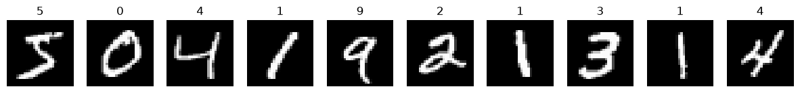

*Ten training digits from MNIST (28 × 28, greyscale).*

</div>

<br>

---

## ✨ What Makes This Project Stand Out

<table>
<tr>
<td width="50%" valign="top">

### 🧼 Clean, Step-by-Step Code
- Many small single-purpose cells; imports appear only where first needed
- No configuration cell and no hard-coded sizes: input shape, number of classes and sequence shapes are read from the data
- Scalers are fitted on the training data only, so test data never leaks into training
- Random seed set once and reused, so runs are repeatable

</td>
<td width="50%" valign="top">

### 🧮 Hand-Checked Numbers
- First hidden layer of the ANN counted by hand: 13 × 16 + 16 = **224**, matching `model.summary()`
- CNN and ANN parameters compared directly: **56,714** vs **109,386**
- Softmax outputs checked: the three probabilities of a test wine add up to **1.0**

</td>
</tr>
<tr>
<td width="50%" valign="top">

### 🔍 Honest Baselines
- The GRU is judged against a **naive baseline** (tomorrow = today), not only against its own loss
- The CNN is judged against an **ANN baseline** on the same data
- The unanswerable question and the wrong fill-mask answers are reported as they happened

</td>
<td width="50%" valign="top">

### 🧰 Five Skills in One Notebook
- Tabular classification, image processing, image classification, time-series forecasting and pre-trained NLP
- Every model and graph has a short interpretation, and the notebook ends with a final interpretation
- Bonus LSTM added next to the GRU

</td>
</tr>
</table>

<br>

---

## 🗺️ Full Project Journey

<div align="center">

| Step | Focus | Key Output |
|:---:|:---|:---|
| 🍷 **Step 1** | ANN on Wine data | Class distribution · feature ranges · scaling · one-hot labels · 13-16-8-3 ANN · curves · confusion matrix |
| 🖼️ **Step 2** | OpenCV | Resize · HSV · orange colour mask · erode + dilate · Sobel edges · Haar face detection · 5 × 5 summary grid |
| 🔢 **Step 3** | CNN vs ANN on MNIST | Conv + pooling CNN · ANN baseline · EarlyStopping · confusion matrix · wrong predictions · feature maps |
| 🌡️ **Step 4** | GRU forecasting | Cleaning · 30-day windows · GRU · naive baseline · RMSE and MAE · bonus LSTM |
| 🤖 **Step 5** | Transformers | Fill-mask · question answering table · Hinglish test · text generation and temperature · confidence chart |
| 📋 **Step 6** | Comparison | Results summary table · written reflection · final interpretation |

</div>

<br>

---

## 🍷 Step 1 · ANN on Wine Data

| Item | Detail |
|:---|:---|
| **Split** | 142 train / 36 test (80/20, stratified, seed 42) |
| **Preprocessing** | `StandardScaler` fitted on the training set; labels one-hot encoded (3 columns) |
| **Architecture** | Input 13 → Dense 16 (ReLU) → Dense 8 (ReLU) → Dense 3 (Softmax) |
| **Parameters** | 224 + 136 + 27 = **387** |
| **Training** | Adam, categorical cross-entropy, 60 epochs, batch size 8, 20% validation split |

<div align="center">
<table>
<tr>
<td align="center" width="50%">

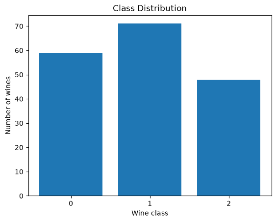

*Class 1 has the most wines (71) and class 2 the fewest (48).*

</td>
<td align="center" width="50%">

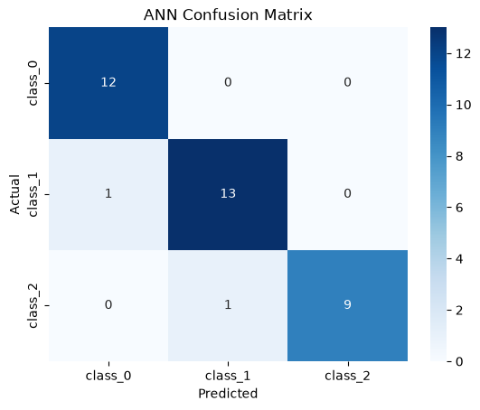

*Only 2 of 36 test wines are predicted wrongly.*

</td>
</tr>
</table>

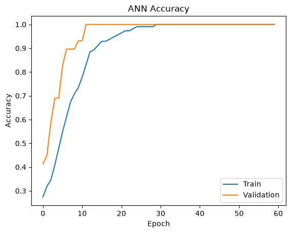 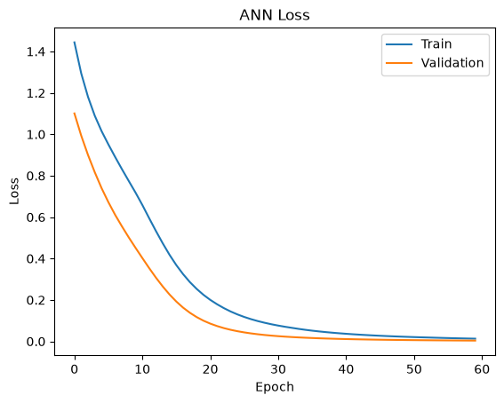

*Accuracy rises fast and stays high; train and validation lines stay close, so there is no strong overfitting.*

</div>

**Test accuracy: 94.44%**

| Class | Precision | Recall | F1-score | Support |
|:---|:---:|:---:|:---:|:---:|
| class_0 | 0.92 | 1.00 | 0.96 | 12 |
| class_1 | 0.93 | 0.93 | 0.93 | 14 |
| class_2 | 1.00 | 0.90 | 0.95 | 10 |

`proline` (278 to 1680) and `nonflavanoid_phenols` (0.13 to 0.66) have very different ranges, which is why the features were scaled first.

<br>

---

## 🖼️ Step 2 · OpenCV

**Pipeline (all five images, resized to 256 × 256):** BGR → HSV → orange mask `[10, 100, 70]` to `[25, 255, 255]` with `cv2.inRange` and `cv2.bitwise_and` → erosion then dilation (5 × 5 kernel) → Sobel edges (x and y combined) → Haar cascade face detection (`scaleFactor` 1.1, `minNeighbors` 5).

<div align="center">

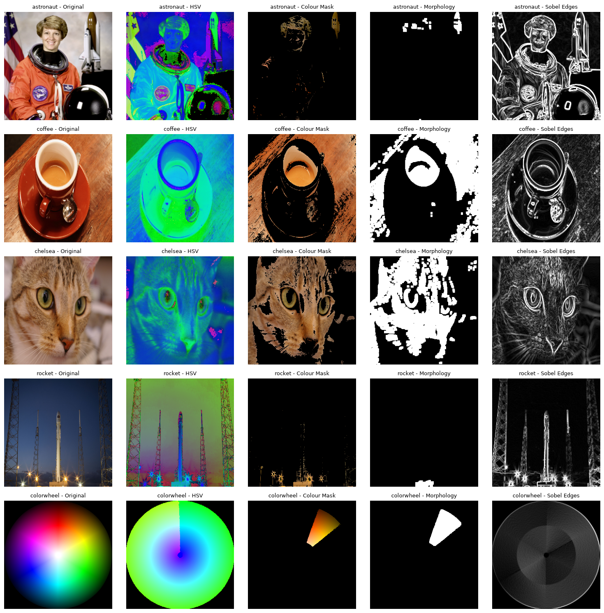

*Original, HSV, colour mask, morphology and Sobel edges for all five images.*

</div>

<div align="center">
<table>
<tr>
<td align="center" width="50%">

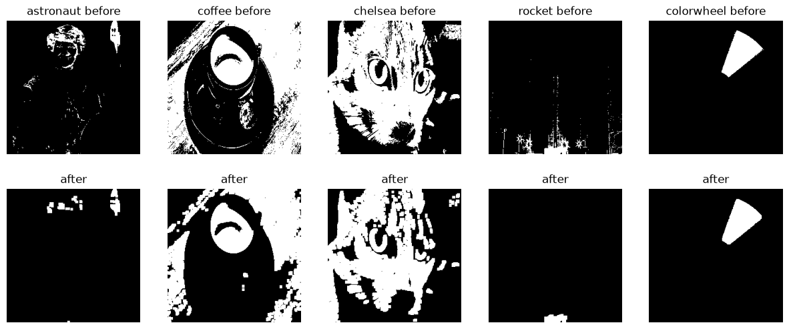

*Erode then dilate removes tiny white dots and keeps the main shapes.*

</td>
<td align="center" width="50%">

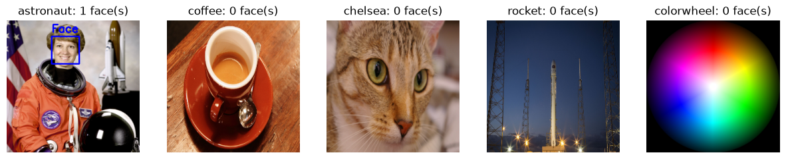

*Only the astronaut image contains a human face.*

</td>
</tr>
</table>
</div>

| `minNeighbors` | Faces found in the astronaut image |
|:---:|:---:|
| 2 | 2 *(one is a false positive)* |
| 5 | 1 |
| 8 | 1 |

32 images (six per picture plus the summary grid and face row) are saved in `outputs/`.

<br>

---

## 🔢 Step 3 · CNN vs ANN on MNIST

| Item | Detail |
|:---|:---|
| **Data** | First 20,000 training and 4,000 test images, divided by 255 and reshaped to `(28, 28, 1)` |
| **CNN** | Conv 16 (3×3) → MaxPool → Conv 32 (3×3) → MaxPool → Flatten → Dense 64 → Dense 10 |
| **ANN baseline** | Flatten → Dense 128 → Dense 64 → Dense 10 |
| **Training** | Adam, 8 epochs, batch size 64, 10% validation split; EarlyStopping (patience 2, best weights restored) on the CNN |

<div align="center">

| Model | Total Parameters | Test Accuracy |
|:---|:---:|:---:|
| **CNN** | **56,714** | **0.9728** |
| ANN | 109,386 | 0.9545 |

</div>

<div align="center">
<table>
<tr>
<td align="center" width="50%">

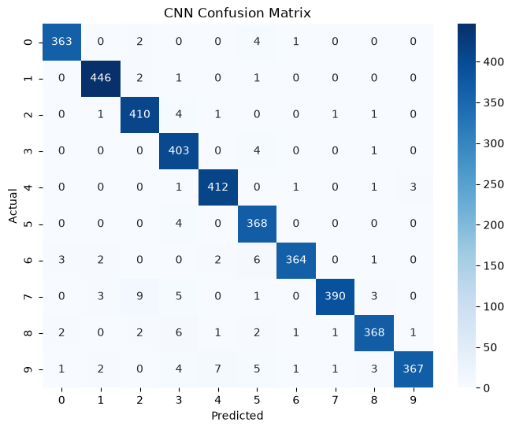

*109 of 4,000 test digits are wrong. The most common mistake is a 7 predicted as a 2 (9 times).*

</td>
<td align="center" width="50%">

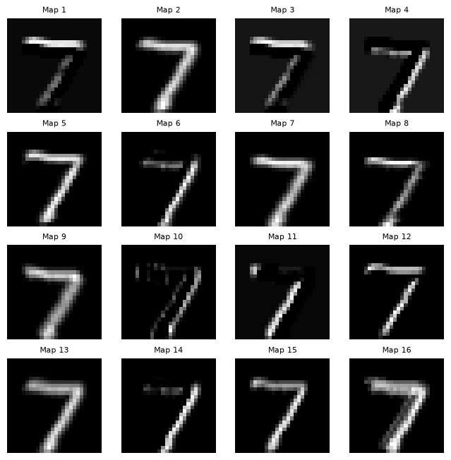

*The 16 feature maps of the first Conv2D layer for one test digit.*

</td>
</tr>
</table>

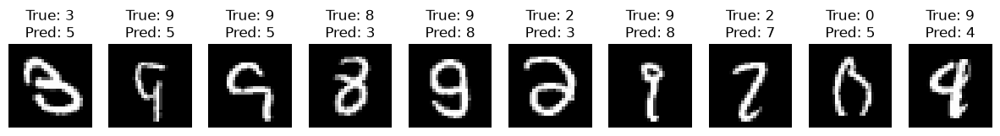

*Ten digits the CNN got wrong, with the true and predicted label.*

</div>

The CNN reaches higher accuracy with about **half the parameters** of the ANN, because one small 3 × 3 filter is reused over the whole image instead of giving every pixel its own weight. Precision and recall are 0.94 or higher for all ten digits.

<br>

---

## 🌡️ Step 4 · GRU Temperature Forecasting

| Item | Detail |
|:---|:---|
| **Data** | 3,650 daily minimum temperatures, 1981 to 1990; no stray or missing values were found |
| **Split** | First 80% for training (2,920 days), last 20% for testing (730 days), no shuffling |
| **Scaling** | `MinMaxScaler` fitted on the training days only |
| **Windows** | 30 days in, next day out → 2,890 train and 700 test sequences |
| **Model** | GRU (32 units, tanh) → Dense 1; Adam, MSE, 15 epochs, batch size 32 |
| **Baseline** | Naive: predict that tomorrow equals today |

<div align="center">

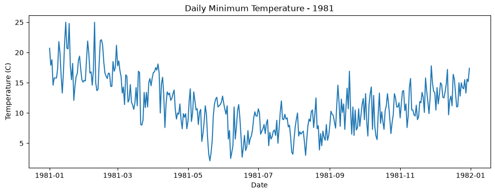 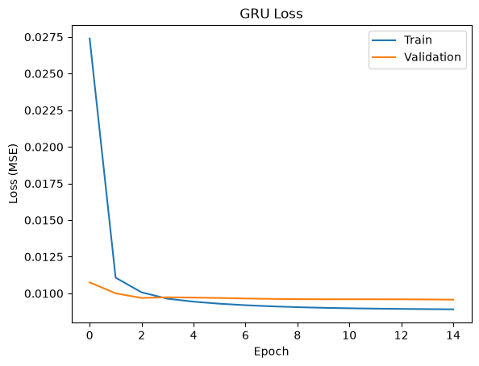

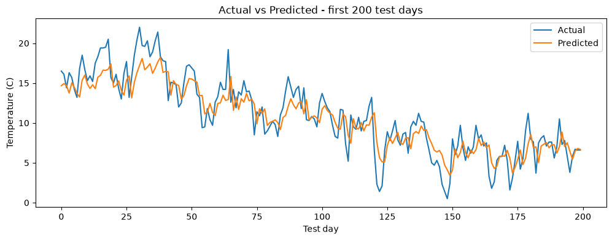

*The prediction follows the up-and-down movement but is smoother than the real line and misses sudden jumps.*

</div>

<div align="center">

| Model | RMSE (°C) | MAE (°C) |
|:---|:---:|:---:|
| GRU | 2.309 | 1.828 |
| **LSTM** *(bonus)* | **2.286** | **1.802** |
| Naive baseline | 2.486 | 1.951 |

</div>

The GRU beats the naive baseline by about **7%** in RMSE. The LSTM is almost the same as the GRU, so the lighter GRU is enough for this data.

<br>

---

## 🤖 Step 5 · Transformers

### Fill-Mask (`distilbert-base-uncased`)

| Sentence | Top 3 predictions (score) |
|:---|:---|
| The capital of India is `[MASK]`. | pune (0.156), bangalore (0.148), mumbai (0.078) |
| The Taj Mahal is located in `[MASK]`. | agra (0.157), delhi (0.128), lahore (0.109) |
| ISRO is the space `[MASK]` of India. | agency (0.479), arm (0.048), corporation (0.041) |
| Mumbai is the financial capital of `[MASK]`. | india (0.468), maharashtra (0.322), mumbai (0.094) |
| My favourite Indian food is `[MASK]`. | chicken (0.144), curry (0.064), vegetarian (0.046) |

The ISRO and Mumbai sentences get confident, correct answers. For the capital sentence **all three answers are wrong** (the correct answer, Delhi, is not in the top 3): the model predicts words from text patterns, not from checked facts. The last sentence has many valid answers, so its scores are low and spread out.

### Question Answering (`distilbert-base-cased-distilled-squad`)

**9 of 10 answers are correct.** The only wrong one is the deliberately unanswerable question.

| # | Question | Predicted answer | Score | Correct |
|:---:|:---|:---|:---:|:---:|
| 1 | Where is the headquarters of ISRO? | Bengaluru | 0.975 | ✅ |
| 2 | Which mission reached the orbit of Mars in 2014? | Mars Orbiter Mission | 0.833 | ✅ |
| 3 | Who built the Taj Mahal? | Mughal emperor Shah Jahan | 0.611 | ✅ |
| 4 | How tall is the main dome of the Taj Mahal? *(unanswerable)* | white marble | 0.759 | ❌ |
| 5 | When did the first passenger train run in India? | 1853 | 0.994 | ✅ |
| 6 | Between which two cities did the first passenger train run? | Bombay and Thane | 0.967 | ✅ |
| 7 | Which organisation developed UPI? | National Payments Corporation of India | 0.762 | ✅ |
| 8 | In which year was UPI launched? | 2016 | 0.998 | ✅ |
| 9 | Along which sea is Mumbai located? | Arabian Sea | 0.781 | ✅ |
| 10 | What was Mumbai earlier called? | Bombay | 0.988 | ✅ |

<div align="center">

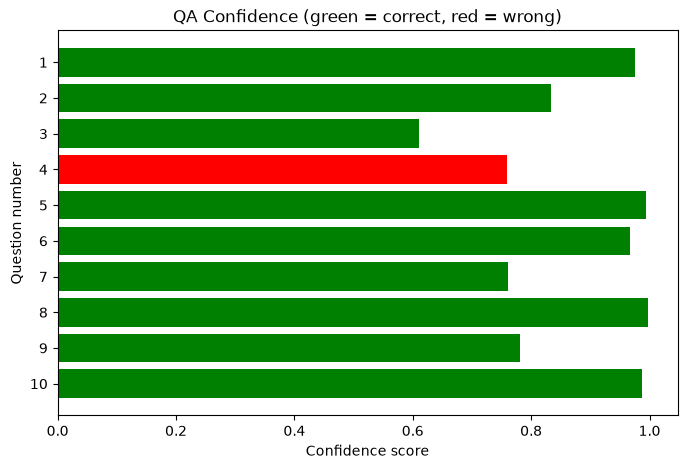

*Green = correct, red = wrong. The unanswerable question still gets a high score (0.76), so confidence alone cannot catch it.*

</div>

A Hinglish question (*"ISRO ka headquarters kahan hai?"*) was also answered correctly (**Bengaluru**, score 0.865).

### Text Generation (`distilgpt2`)

Three prompts were completed twice each, then one prompt was run at temperature **0.5** and **1.5**. Low temperature gave safer, more repeated text; high temperature gave more varied but less meaningful text. The model is small, so even fluent outputs can be off-topic or factually wrong.

<br>

---

## 📈 Results Summary

<div align="center">

| Step | Task | Dataset | Key Metric | Result |
|:---|:---|:---|:---|:---:|
| **1 · ANN** | Multi-class classification | Wine (178 wines) | Test accuracy | **94.44%** |
| **2 · OpenCV** | Preprocessing and detection | 5 images | Faces detected | **1 face** (astronaut) |
| **3 · CNN** | Image classification | MNIST (20,000 / 4,000) | Test accuracy | **CNN 97.28%** / ANN 95.45% |
| **4 · RNN** | Time-series regression | Melbourne temperature (3,650 days) | RMSE | **GRU 2.31 °C** vs naive 2.49 °C |
| **5 · Transformers** | Pre-trained inference | 5 paragraphs, 10 questions | Correct answers | **9 / 10** |

</div>

**What the results show**
- **The CNN beat the ANN** by 1.83 points (0.9728 vs 0.9545) with about half the parameters.
- **The GRU beat the naive baseline** by about 7% in RMSE; the bonus LSTM was only slightly better than the GRU.
- **The Wine ANN reached 94.44%** with very little code; with only 36 test wines, one mistake changes the score by about 2.8 points.
- **Pre-trained models need checking:** the fill-mask model got the capital of India wrong and the QA model answered an unanswerable question with a high score.

**Limitations (observations only):**
- Each model was trained once, so small differences (for example GRU vs LSTM) are not conclusive.
- MNIST was reduced to 20,000 training and 4,000 test images and trained for only 8 epochs, so scores are below those of a full-data run.
- The Wine test set has only 36 samples.
- The "Correct" column in Step 5 compares answers with expected answers written by the author, not with human judges.
- The fifth OpenCV image is a built-in scikit-image picture, not a personal photo.

<br>

---

## 🧪 What This Project Covers (Theory)

<details>
<summary><b>📖 Click to expand — Deep Learning Concepts Covered</b></summary>
<br>

- Why features are scaled before training and why labels are one-hot encoded
- Hidden layers, ReLU and Softmax; categorical cross-entropy; counting parameters by hand
- Reading accuracy and loss curves, a classification report and a confusion matrix
- HSV colour space, colour masks, erosion and dilation, and Sobel edges
- Haar cascade face detection and the effect of `minNeighbors`
- Convolution, pooling, feature maps, weight sharing and why a CNN needs fewer parameters than an ANN
- EarlyStopping and overfitting
- Time-series windows, scaling without data leakage, and why a naive baseline matters
- GRU vs LSTM, RMSE and MAE
- Encoder vs decoder Transformers, self-attention, extractive question answering and temperature in text generation

</details>

<br>

---

## 📦 Requirements

```
tensorflow
tf_keras
scikit-learn
scikit-image
opencv-python
pandas
numpy
matplotlib
seaborn
transformers
torch
```

<br>

---

## 🛠️ Tools Used

| Tool | Used For |
|:---|:---|
| Python 3 / Jupyter Notebook | Development environment |
| TensorFlow 2.x / Keras | ANN, CNN, GRU and LSTM models, EarlyStopping |
| OpenCV | HSV conversion, colour masks, morphology, Sobel edges, Haar face detection |
| scikit-learn | Wine data, scaling, train-test split, metrics |
| scikit-image | Sample images |
| Hugging Face Transformers / PyTorch | Fill-mask, question answering and text generation pipelines |
| pandas / NumPy | Tables, sequences and array handling |
| Matplotlib / Seaborn | All plots |

<br>

---

## 👨‍💻 Author

<div align="center">

### **Ayush Isamaliya**
*Data Science & Aspiring ML Engineer*

</div>

### 🌐 Connect With Me

<div align="center">

[](https://github.com/isamaliya16)
[](https://www.linkedin.com/in/ayush-isamaliya-686533312/)

</div>

<br>

<div align="center">


**Built as part of the Deep Learning track at Red & White Skill Education**


*Made with ❤️ | Deep Learning Practical Exam Set C | ANN · OpenCV · CNN · RNN · Transformers*

</div>
